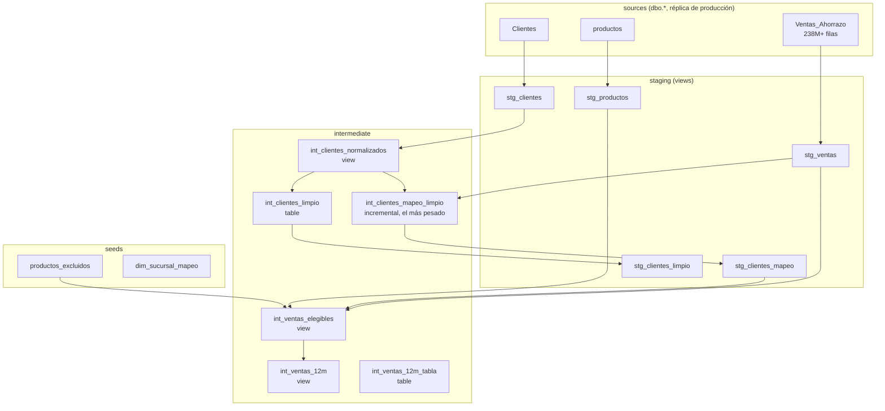
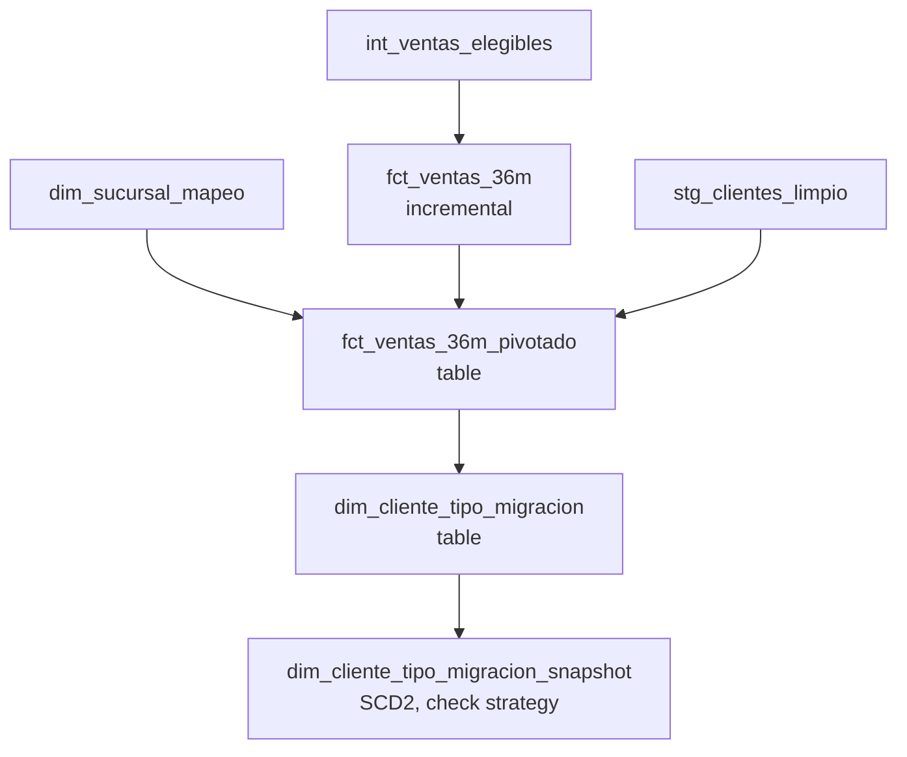
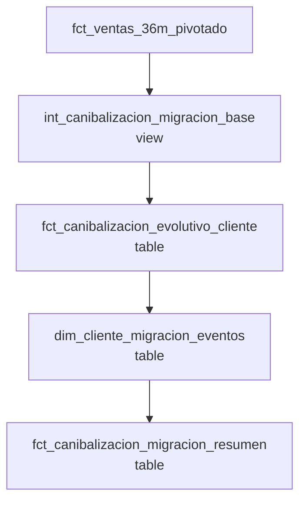
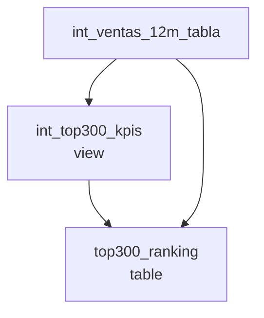
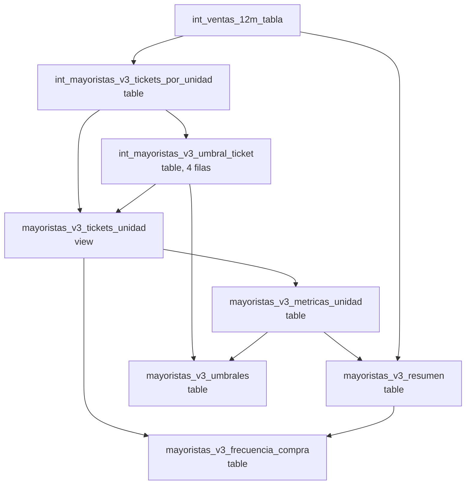

# Arquitectura de dependencias

## Los tres proyectos

`dbt_ahorrazo` es la capa de transformación que comparten los tres proyectos de
datos de Ahorrazo. Cada uno vivía antes como un pipeline propio de Python y
notebooks, con su propia copia de las mismas reglas.

| Proyecto | Qué responde | Mart principal |
|---|---|---|
| **Canibalización de sucursales** | ¿Un cliente que compra en una sucursal nueva es cliente nuevo, o se lo "robamos" a otra sucursal propia? | `dim_cliente_tipo_migracion` (v1) y `fct_canibalizacion_migracion_resumen` (v3) |
| **Top 300 Productos** | ¿Cuáles son los productos más importantes del catálogo, por sucursal? | `top300_ranking` |
| **Clientes Mayoristas** | ¿Qué clientes compran a escala mayorista y con qué nivel? | `mayoristas_v3_resumen` |

Los tres leen las mismas tablas base en SQL Server: `Ventas_Ahorrazo`, con más de
238 millones de filas, `Clientes` y `productos`. Cada proyecto tenía su propia
definición, ligeramente distinta, de qué es una venta válida y de qué es un
cliente limpio. Acá esa lógica se resuelve una sola vez, en las capas `staging` e
`intermediate`, y cada proyecto arma su mart encima con `ref()`. Se orquesta con Airflow, sumado al
Airflow dockerizado que ya opera el equipo de Stock en el mismo
Windows Server (repo separado `orquestacion_ahorrazo`, ver
"Orquestación" más abajo), con DAGs propios, independientes de los de
Stock.

El setup y las convenciones están en [`README.md`](README.md), y los comandos de
uso diario en [`COMANDOS.md`](COMANDOS.md).

## Diagramas de dependencias

Armados leyendo el código modelo por modelo.

Este documento se desactualiza si alguien cambia el código y no lo
actualiza acá. Para el lineage siempre al día, `dbt docs generate` y
`dbt docs serve` son la fuente definitiva. Esto es la versión legible y
versionada en git, para leer sin levantar nada.

---

## Capa base compartida

Todo lo de acá abajo lo consumen los tres proyectos, así que un cambio acá se
propaga a los tres vía `ref()`, sin volver a escribir la regla en cada uno. Es el
motivo de tener un solo repo dbt en lugar de tres.

### Cómo se materializa cada capa

Elegir entre vista y tabla es elegir dónde se paga el costo. Una vista no ocupa
espacio y devuelve siempre el dato actual, pero vuelve a ejecutar su consulta en
cada lectura. Una tabla se calcula una vez y después se lee barato, a cambio de
ocupar espacio y de quedar congelada hasta la próxima corrida.

La decisión se toma modelo por modelo, con dos preguntas: cuánto cuesta calcular
el resultado, y cuántas veces se lo va a leer.

**`staging` va como vista.** Cada modelo devuelve una fila por cada fila de la
fuente y solo cambia nombres de columna, tipos y algún filtro simple. Calcularlo
cuesta prácticamente lo mismo que leer la tabla original, así que resolverlo en
cada lectura no agrega trabajo. Materializar `stg_ventas` guardaría una segunda
copia de 238 millones de filas con exactamente el mismo contenido, y agregaría un
paso de actualización que puede quedar atrasado respecto de la fuente.

**`marts` va como tabla.** Un mart es el resultado de joins, ventanas y
agregaciones sobre millones de filas, y lo consultan tableros que se abren varias
veces por día. Calcularlo una vez por corrida y leerlo muchas veces es el reparto
de costo que corresponde. dbt lo construye en una tabla nueva y la intercambia al
final, así que quien esté consultando la tabla anterior no ve un estado
intermedio.

**`intermediate` no tiene una regla única**, y por eso `dbt_project.yml` no le
fija materialización: cada modelo declara la suya. `int_clientes_limpio` es una
dimensión chica que se une contra la fact, y como tabla evita repetir ese trabajo
en cada consumidor. `int_clientes_mapeo_limpio` y `fct_ventas_36m` son
incrementales, porque reconstruirlos enteros lleva entre 47 y 67 minutos y solo
cambian las filas recientes. `int_ventas_12m` es una vista liviana sobre un
modelo que ya hizo el trabajo pesado, e `int_ventas_12m_tabla` es esa misma vista
materializada, por un motivo distinto: la ventana de la vista se mueve con el calendario y las
tablas que la consumen no, así que materializarla las mantiene alineadas.

### Por qué existe `staging` y no se va directo a `intermediate`

- Es el **único punto de contacto con `source()`** de todo el proyecto
  Todo lo demás usa `ref()`. Si una fuente cruda cambia de forma, hay
  un solo lugar que actualizar.
- La limpieza básica (tipos, nombres, collation) se resuelve **una sola
  vez**. Un ejemplo real: `producto_id` casteado a `varchar(100)` acá
  evita que cada modelo de `intermediate` tenga que acordarse de
  castear por su cuenta (la misma clase de duplicación que esta
  migración a dbt vino a resolver).
- Es donde anclan los `contract` de `stg_ventas` y `stg_productos`. Un
  solo punto de entrada confiable, en vez de necesitar un contract por
  cada modelo que tocara la fuente cruda directo.
- Detecta roturas de la fuente rápido y en el lugar correcto: un
  `SELECT` simple falla obvio, en vez de esconderse dentro de un modelo
  intermedio con varios JOINs y lógica de negocio alrededor.



**`int_ventas_elegibles`** es la única fuente de verdad de "qué es una
venta válida para análisis" (empresa=3, exclusión de categorías
bolsa/egre/servi, cliente de test, productos de `productos_excluidos`):
la consumen directo o indirecto los 3 proyectos.

**`int_ventas_12m`** es la ventana móvil de 12 meses (meses cerrados)
compartida entre Top 300 y Mayoristas. No existía como pieza separada
en el diseño original, se extrajo al detectar que los dos la
recalculaban por separado.

**`int_ventas_12m_tabla`** son esas mismas filas materializadas, y es lo
que consumen los marts y el tablero de Power BI. La vista sigue existiendo
para consultas a mano, pero nadie la lee en producción: al ser vista,
recalcula la ventana contra `getdate()` en cada consulta, así que el
primero de cada mes empieza a devolver un período distinto sin que se haya
corrido nada, y eso desalinea las tablas de `marts_mayoristas`, que
guardan la ventana del día en que se construyeron, contra la venta que ve
Power BI. Materializarla además baja de ocho recorridos de la cadena sobre
`dbo.Ventas_Ahorrazo` por corrida a uno solo.

### Orden de ejecución de esta capa

1. Sources. Nada que ejecutar, es la base replicada.
2. `stg_ventas`, `stg_productos` y `stg_clientes`, en paralelo entre sí.
3. `int_clientes_normalizados`.
4. `int_clientes_mapeo_limpio` (incremental, **47–67 min en
   `--full-refresh`**, el cuello de botella real del proyecto) e
   `int_clientes_limpio`, en paralelo entre sí.
5. `stg_clientes_mapeo` y `stg_clientes_limpio`, en paralelo entre sí.
6. `int_ventas_elegibles` (necesita `stg_ventas` + `stg_clientes_mapeo` +
   `stg_productos` + seed `productos_excluidos`).
7. `int_ventas_12m` y, encima, `int_ventas_12m_tabla`. Esta última es
   la que consumen los marts.

---

## Canibalización



### Orden de ejecución
```
dbt build --select +dim_cliente_tipo_migracion
dbt snapshot --select dim_cliente_tipo_migracion_snapshot
```
(el `+` resuelve `fct_ventas_36m` → `fct_ventas_36m_pivotado` →
`dim_cliente_tipo_migracion` solo, ver nota general abajo)

### Canibalización v3, eventos de migración

Metodología distinta a `dim_cliente_tipo_migracion` (ventana de 24
meses, eventos de migración por sucursal en vez de acumulado corrido):
portada de `canibalizacion_v3.py`, preservando dos comportamientos no obvios del
código original (ver el comentario en `dim_cliente_migracion_eventos.sql`).

El DAG semanal reconstruye solo la cadena de la v1, así que estos cuatro modelos
no los actualiza ninguna corrida programada. Cambiar el selector del DAG a
`+tag:canibalizacion` lo resuelve, y es independiente de decidir el cutover.



### Orden de ejecución
```
dbt build --select +fct_canibalizacion_migracion_resumen
```

---

## Top 300 Productos



### Orden de ejecución
```
dbt build --select +top300_ranking
```

---

## Clientes Mayoristas



`mayoristas_v3_resumen` toma de `int_ventas_12m_tabla` la venta para C3, que
entra con todas las unidades de medida y no solo con las cuatro que tienen
corte de volumen.

`mayoristas_v3_tickets_unidad` es una vista: son las mismas filas que
`int_mayoristas_v3_tickets_por_unidad` con los cortes al lado, y materializarla
guardaría 7,4 millones de filas dos veces. El detalle de por qué la cadena
tiene esta forma está en `models/marts/mayoristas/README.md`.

### Orden de ejecución
```
dbt build --select +tag:mayoristas
```
El tag está declarado a nivel carpeta en `dbt_project.yml`, así que cualquier
modelo nuevo en `marts/mayoristas/` entra sin tocar el DAG. La versión anterior
de la metodología se eliminó del repo; los objetos que dejó en la base se dan de
baja con `analyses/limpiar_objetos_mayoristas_v2.sql`.

---

## Cómo se ejecuta esto en la práctica

En el día a día **no hace falta memorizar ni escribir el orden a
mano**: `dbt build --select +<modelo>` resuelve el grafo de dependencias
solo, seeds incluidos. Los diagramas de arriba son para *entender* el
grafo (qué depende de qué, dónde está el cuello de botella real), no un
procedimiento manual paso a paso.

**Para reconstruir todo el proyecto de una vez**, con los tres proyectos, la
capa base y el snapshot, en el orden correcto:
```
dbt build
```

### Lo que dbt NO resuelve solo

- **`--full-refresh` es siempre explícito, nunca automático.** Los 2
  modelos incrementales (`int_clientes_mapeo_limpio`, `fct_ventas_36m`)
  solo reprocesan su ventana de lookback en una corrida normal. Si
  cambia una regla que afecta datos históricos ya cargados (pasó al
  migrar `fct_ventas_36m` a `int_ventas_elegibles`), hace falta
  `--full-refresh` puntual sobre ese modelo. dbt no lo detecta ni lo
  sugiere.
- **El snapshot no corre dentro de un `dbt build` con selector.** `dbt build`
  sin selector sí lo incluye al final, pero
  `dbt build --select +dim_cliente_tipo_migracion` no lo toca: hace falta
  `dbt snapshot --select ...` explícito. Y `dbt snapshot --full-refresh`
  **borra toda la historia acumulada**. Nunca usarlo salvo que sea intencional.
  Queda un solo snapshot en el proyecto, el de Canibalización: el de Mayoristas
  se eliminó junto con la versión anterior de esa metodología, así que la
  clasificación vigente no guarda historia mes a mes.
- **La alerta de actualización no corre dentro de `dbt build` ni `dbt
  snapshot`**. Es un comando aparte (`dbt test --select
  assert_ventas_actualizada_mes_cerrado`). No usa `dbt source
  freshness` (ese mecanismo solo soporta umbrales relativos tipo "hace
  N días" y no un corte de calendario). Es un test singular
  (`tests/assert_ventas_actualizada_mes_cerrado.sql`, `severity: warn`)
  que compara `fecha_venta` contra el último día del mes cerrado más
  reciente, vía el macro `fecha_corte_mes_cerrado()`. Automatizado vía
  `dbt_ahorrazo_diario` (ver "Orquestación" abajo).
- **Cuando se mueve un objeto de schema** (pasó con la restructuración a
  `staging`/`intermediate`/`marts_*`), cualquier modelo no reconstruido
  desde el cambio "no existe" en su ubicación nueva aunque exista en la
  vieja. Un `dbt build` sin selector, corrido una vez, resuelve esto de
  raíz para todo el proyecto.

---

## Orquestación (Airflow)

El único Airflow del server es el dockerizado del equipo de Stock
(`stock_dato/ahorrazo/`). Sales no tiene un Airflow propio y se suma al
mismo, vía volúmenes adicionales en su `docker-compose.yml`, con DAGs
**propios e independientes** (repo `orquestacion_ahorrazo`, sibling de
este repo), sin encadenarse al `dag_orquestador` de Stock ni a su
lógica de retry/email.

| DAG | Qué corre | Horario (UTC) | Por qué ese horario |
|---|---|---|---|
| `dbt_ahorrazo_mensual` | `+tag:mayoristas` y `fct_ventas_agrupadas_24m` | Día 1, 02:00 | Más margen: Mayoristas es el más nuevo y su tiempo de corrida varía |
| `dbt_ahorrazo_semanal` | `dim_cliente_tipo_migracion` + su snapshot, `top300_ranking` | Lunes, 04:00 | `dbt build` completo mide ~1h30 (dato real) |
| `dbt_ahorrazo_diario` | `dbt test --select assert_ventas_actualizada_mes_cerrado` | Todos los días, 05:30 | Liviano, corre en segundos |

Los 3 terminan bien antes de las 07:00 UTC, cuando arranca el
`dag_orquestador` de Stock (ETL → diarias → semanales, con timeouts de
hasta 3-4h cada uno).


Cómo invocan `dbt` las tareas: cada una es un `PythonOperator` que llama
a un `main()` de `scripts/dbt_ahorrazo/` (mismo patrón que ya usan las
tareas de Stock), que a su vez corre `dbt` vía `subprocess` contra un
venv Linux propio, separado del Python de Airflow (nunca se instaló
`dbt-core` en el `requirements.txt` de Stock).
